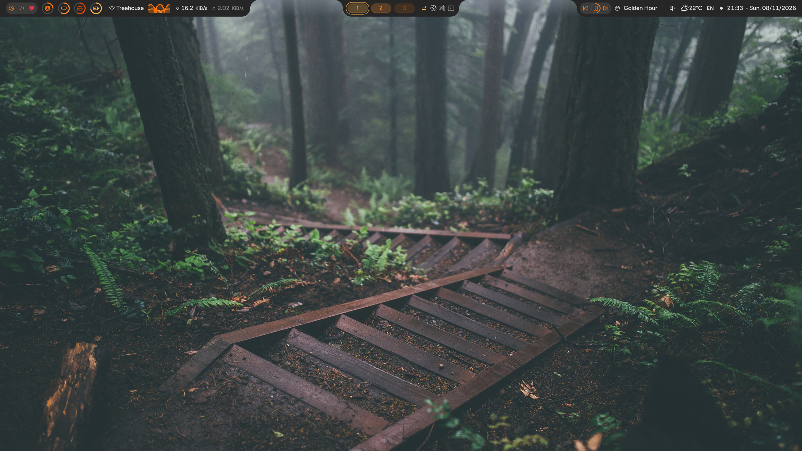
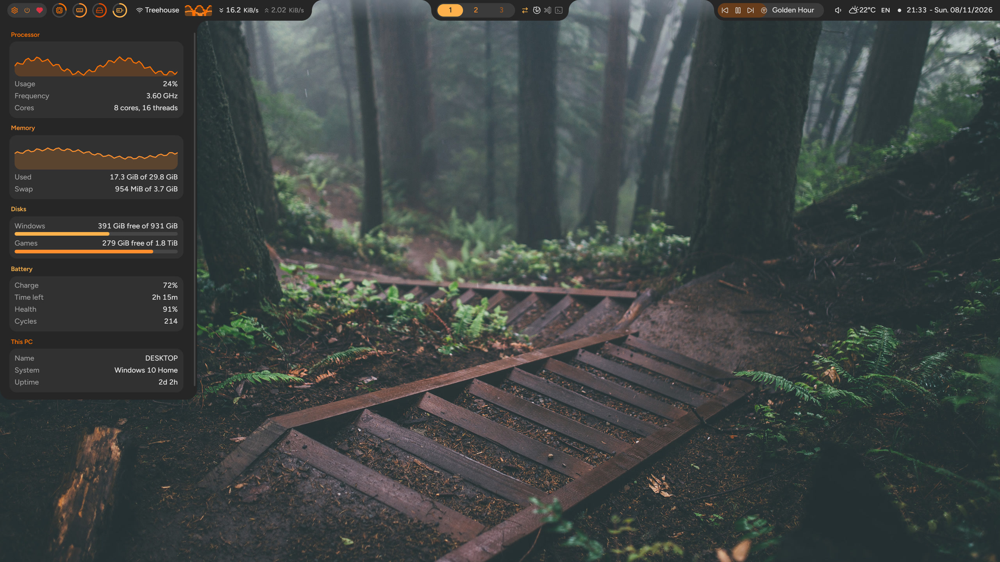
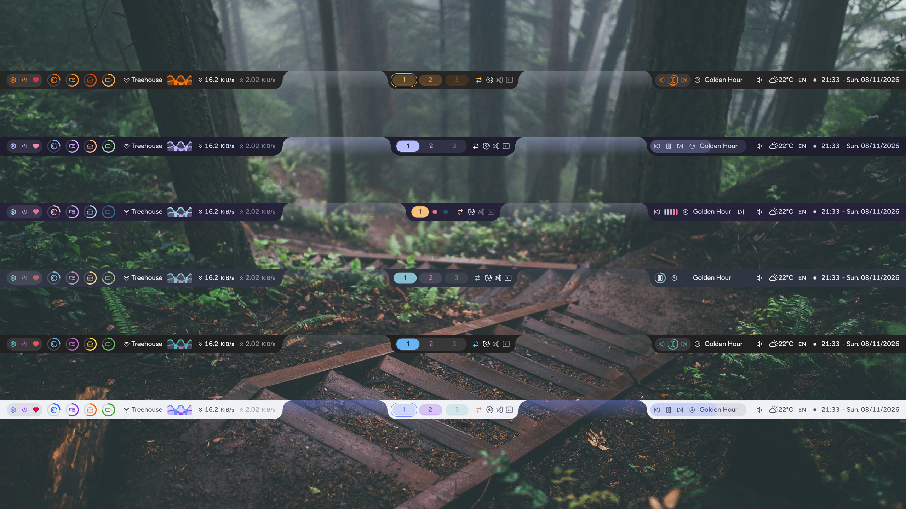
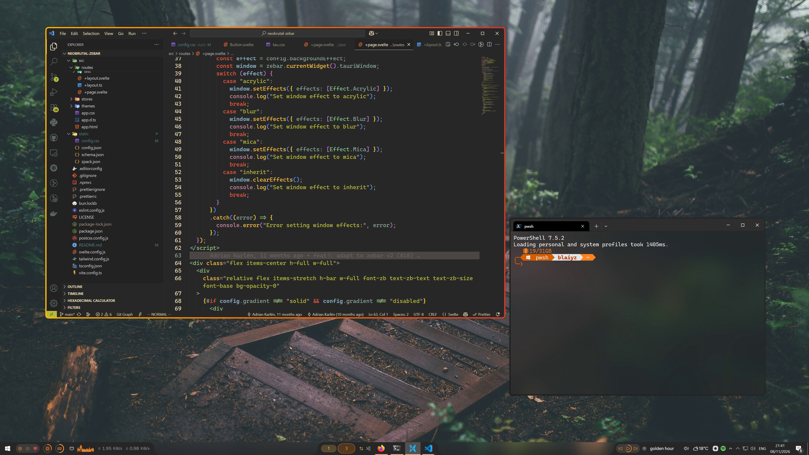
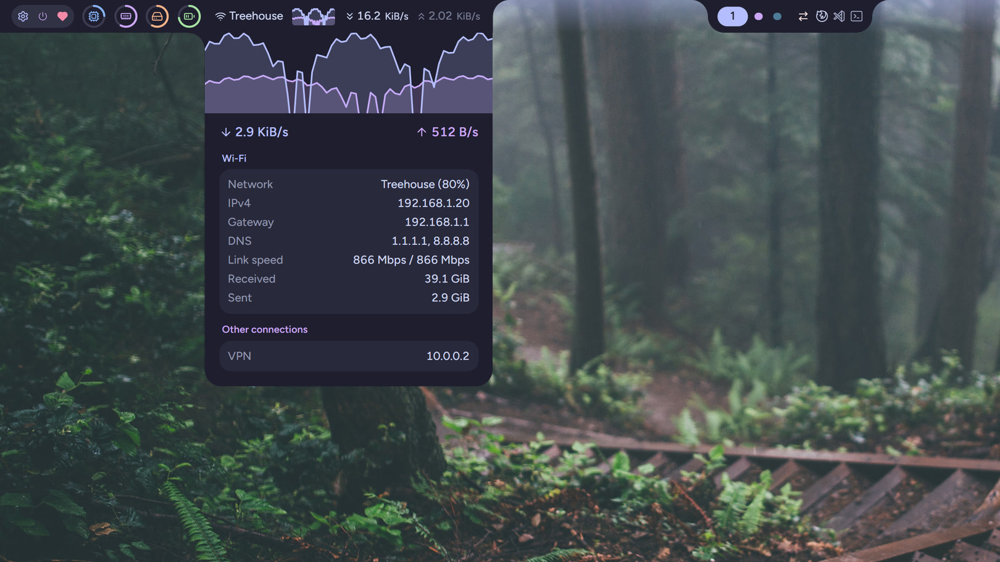
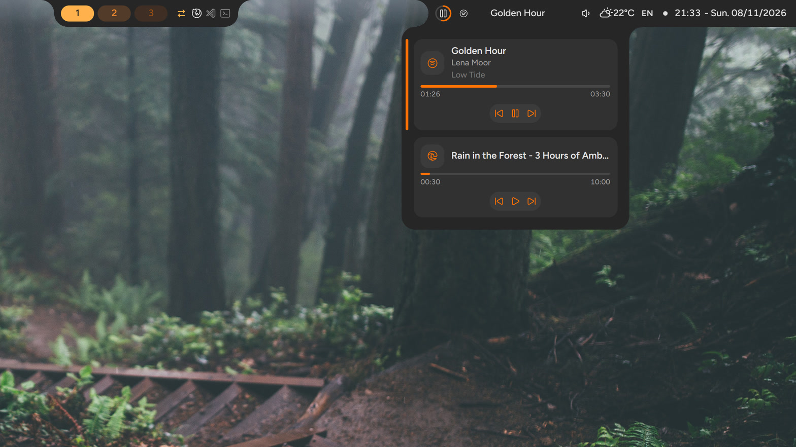
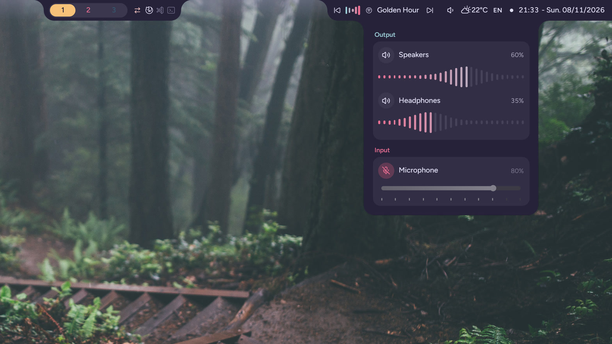
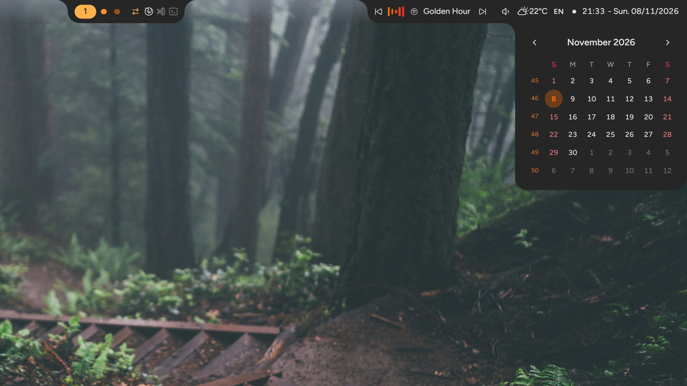
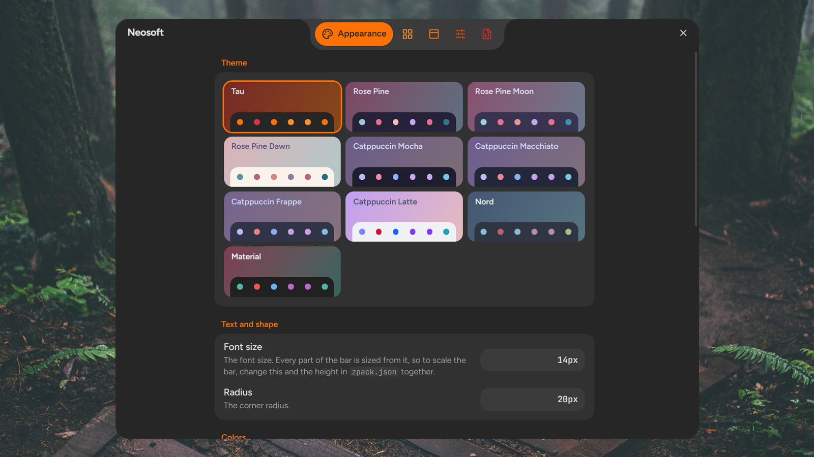
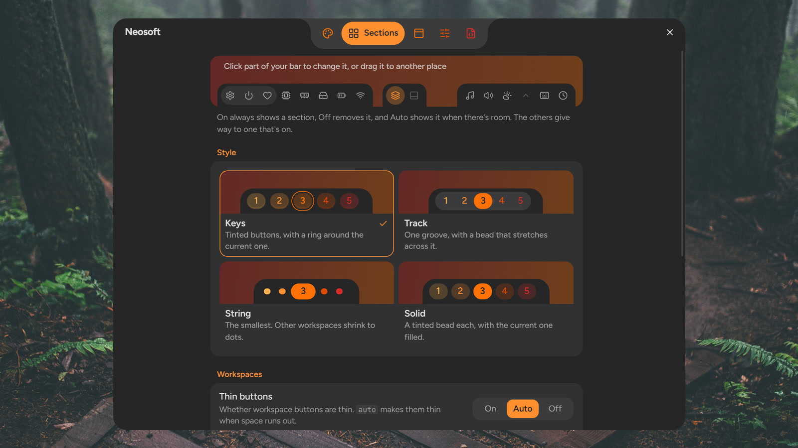

# Neosoft [Zebar](https://github.com/glzr-io/zebar)

A Zebar v3 configuration built with Svelte and Tailwind, forked from [Neobrutal Zebar](https://github.com/adriankarlen/neobrutal-zebar). This project wouldn't have been possible without the original, so please give it a star!

## ✨ Features

- Process icons for the current workspace, with focus indicators
- System meters that change color with their readings
- Smooth animations
- Media controls
- A settings window with a live preview, which can also share your settings and themes as a file
- Flyouts for audio devices, media players, the calendar, network and system details, and power options
- Customizable layout and appearance
- Built-in auto-tiler
- Multi-monitor support
- Windows taskbar integration (experimental)
- Background effects (Acrylic, Blur, Mica)
- Click-through mode, which passes the mouse through the bar to the windows below

## 🖼️ Showcase







More in the [Gallery](#-gallery).

### Taskbar Integration



## 🚀 Getting Started

### Simple Installation

Whichever way you install it, you can then change the settings to suit you (see [Configuration](#-configuration) and [Themes](#-themes)).

#### Marketplace

Search for `neosoft-zebar` in the Zebar marketplace and click install.

It's installed to `%APPDATA%\zebar\downloads\blaiyz.neosoft-zebar@<version>`, which is where you'll find its config files.

#### Manual

Download `neosoft-zebar.zip` from the latest release, extract it into a folder, and put that folder in your Zebar config directory (`%USERPROFILE%\.glzr\zebar`).

### Advanced Installation (Building from Source)

#### Prerequisites

- [Node.js](https://nodejs.org), the version in `.node-version`.
- [pnpm](https://pnpm.io/installation), the version in the `packageManager` field of `package.json`. The repository only supports pnpm.

#### Instructions

1. Clone or download the repository anywhere.
2. So that you don't have to copy files after every rebuild, create a symlink in your Zebar config directory that points to the repository's `build` folder.
3. Open a terminal in the repository's root folder.
4. Install the dependencies:
   ```bash
   pnpm install
   ```
5. Start the dev build, which rebuilds on every change:
   ```bash
   pnpm run dev
   ```
6. Reload Zebar once. After that, the widget reloads itself after each rebuild.

> [!NOTE]
> The first `pnpm run dev` copies `static` into a local folder called `dev_static`, which isn't committed. Keep your own configuration there, so the original files stay untouched. `pnpm run build` makes a release build from `static` instead, so you won't usually need it unless you're preparing a release.

To work on the look of the bar in a normal browser, run `pnpm run dev:mock`. It starts a dev server with hot reload and fake data.

## 🔧 Configuration

Neosoft Zebar keeps its settings in Zebar's storage, not in the installed pack's folder, so they survive updates. There are two ways to change them, and you can use both.

1. **The settings window** opens from the gear button in the bar (at the left end by default), or from the `settings` widget's `default` preset in Zebar's tray menu. Changes apply to every bar as you make them. Its Config page can export all your settings, or just your theme, to the clipboard or your Downloads folder, and import them again, so you can share a theme by pasting it. Exports leave out which tray icons are pinned and their order, since those depend on the apps on your PC. The Config page's Undo goes back to before the last import or reset.

2. **`config.json`** is in the pack's folder. Edit it, then reload Zebar with **Empty cache & reload configs** from its tray menu.

Only include what you want to change. Everything else keeps its default, so a new release can improve those defaults for you:

```jsonc
{
  "$schema": "./schema.json",
  "version": 2,
  "bar": { "direction": "bottom", "gradient": "solid" },
  "theme": { "preset": "nord" },
  "sections": { "cpu": true, "power": false },
  "clock": { "showSeconds": true }
}
```

Open `config.json` in VS Code, or any editor that supports JSON Schema, to see a description and the allowed values for each field as you type. The schema ships alongside it as `schema.json`.

**The last change wins.** `config.json` is only read when its contents change, and is ignored after that, so a later change in the settings window takes over. Replacing the file during an update changes nothing, because the settings in it are already stored.

**Mistakes don't break the bar.** An invalid value is ignored and everything else still applies. A warning icon appears in the bar until you fix the file. Hover over it to see which settings were ignored.

**Sections** can be `true` (always shown), `false` (removed, and its data is no longer collected, although the System flyout still shows the disks) or `"auto"`, the default, which shows a section when there's room for it. `network` can also be `"interface"` or `"statistics"`. `disk` and `keyboard` are off until you turn them on. `bar.primaryMonitorOnly` lists the sections that only appear on the primary monitor.

**Arranging:** on the Sections page of the settings window, drag sections between the left, middle and right groups. The workspaces move the same way, and the settings, power and heart buttons move as one. With taskbar integration, the taskbar's icons stay in the center, and anything in the middle group sits on either side of them. In `config.json`, this is `arrangement`, with a list for each group.

**Styles:** `workspaces.style` and `media.style` each have four looks, with live previews on the Sections page of the settings window.

**Performance:** the bar is always on screen, so it pays to keep it light. These settings are on the Behavior page of the settings window:

- `performance.animations` controls how much the bar animates. `interactive`, the default, only animates what you do, like hovering over the bar or switching workspaces. `all` also animates changes on their own, like the meters as new readings come in, and `none` turns animations off.
- Turning off `performance.keepFlyoutsReady` saves around 40 MB by closing the flyout window while it isn't used, but opening a flyout then takes about a second.
- Longer `providers.refreshIntervals` save CPU and GPU time.

When the bar runs out of room, `"auto"` sections shorten and then hide, least useful first, and come back when there's room again. A section set to `true` never gives way, so the others make room for it. `clock.fullDate` and `workspaces.thinButtons` work the same way.

Right-clicking the clock shows or hides the date, and saves the choice. Showing it sets `clock.fullDate` to `"preferred"`: other sections give way to it, but it can still shorten if they can't make enough room, and if there's no room for it at all, the click does nothing. Clicking the weather switches between Celsius and Fahrenheit, which is saved too. Saved settings apply to every monitor.

The widget's size and position are set in `zpack.json`, Zebar's own configuration file for the pack, which is in the same folder.

> [!NOTE]
> If you use display scaling in Windows, you may need to change the height in `zpack.json` (`40px` by default).

### Flyouts

Clicking a section opens a popup beside it, which closes when you click anywhere else:

| Section                      | Flyout                                                                     |
| ---------------------------- | -------------------------------------------------------------------------- |
| Volume                       | A slider and mute button for every playback and recording device           |
| Clock                        | A calendar with week numbers                                               |
| Network                      | Addresses, link speed, totals and a graph of recent traffic                |
| CPU, memory, disk or battery | Recent usage, disks, battery health and uptime                             |
| Media title                  | Every player, with its artist, album, progress and controls                |
| Power                        | Lock, sleep, sign out, restart and shut down, which all ask you to confirm |

Restart and shut down wait a minute before they happen, and you can cancel them from the Power flyout. Scrolling over the volume icon changes the volume, over the workspaces switches workspace, and over the media section switches player.

### System tray (experimental)

`sections.tray` shows the system tray in a flyout, along with any icons you pin to the bar. Drag icons to rearrange them, or drag them to the top of the flyout to pin them.

> [!WARNING]
> It's off by default because Zebar's tray provider breaks the native system tray on Windows 10 until Explorer restarts ([zebar#301](https://github.com/glzr-io/zebar/issues/301)). The flyout itself works with the real provider. Icon order and pins are matched by tooltip, because Zebar's icon ids change on every update.

### Upgrading from 1.x

Your old `config.json` still works: put it back, reload, and it's converted. Sections you had turned on become `"auto"`, and anything you turned off stays off.

`config.css` is no longer read, but its contents still work: rename it to `custom.css` (see [Custom CSS](#custom-css)). Keep only the lines you changed, because anything set there overrides the settings. A color set there stays the same in every theme, and `--font-family`, `--font-size`, `--radius` and the taskbar integration sizes override `theme.fontFamily`, `theme.fontSize`, `theme.radius` and `taskbarIntegration`. The Montserrat font from the 1.x template is no longer included.

## 🎨 Themes

Pick a preset with `theme.preset`:

| Preset                                                                              | Theme                                            |
| ----------------------------------------------------------------------------------- | ------------------------------------------------ |
| `tau`                                                                               | Tau, the default                                 |
| `rose-pine`, `rose-pine-moon`, `rose-pine-dawn`                                     | [Rosé Pine](https://rosepinetheme.com/)          |
| `catppuccin-mocha`, `catppuccin-macchiato`, `catppuccin-frappe`, `catppuccin-latte` | [Catppuccin](https://catppuccin.com/)            |
| `nord`                                                                              | [Nord](https://www.nordtheme.com/)               |
| `material`                                                                          | [Material](https://m2.material.io/design/color/) |

To change individual colors, use `theme.colors`, with each color written as HSL without commas, like `0 73% 56%`. A color can also point at another one with `var(--name)`: either one of the theme's own colors, such as `var(--ws-2)`, which follows the preset, or any color in the [bundled palettes](https://github.com/blaiyz/neosoft-zebar/tree/main/src/themes). The Sections page of the settings window lists each section's colors, with the theme's own colors as swatches. All the names are in [`presets.css`](https://github.com/blaiyz/neosoft-zebar/blob/main/src/themes/presets.css).

```json
{
  "theme": {
    "preset": "tau",
    "colors": {
      "text": "0 73% 56%",
      "accent": "var(--rp-love)"
    }
  }
}
```

`theme` also sets the corner radius with `radius`, and the font with `fontFamily` (Figtree is bundled as `Figtree Variable`).

### Custom CSS

For anything else, create a file called `custom.css` next to `config.json`, and reload Zebar with **Empty cache & reload configs**. It's loaded after the theme, so it can override any of the variables in `presets.css`, such as `--bar-margin-x` or `--shadow-size-bar`, and style anything else too:

```css
:root {
  --bar-margin-x: 0.5rem;
  --accent: 300 100% 50%;
}
```

Like `config.json`, it's read when its contents change, and the CSS is then stored, so it survives updates even though the file stays behind in the old version's folder. To remove your CSS, empty the file. Deleting the file keeps the last CSS that was read from it.

For a line or two, `theme.customCss` in `config.json` does the same job:

```json
{ "theme": { "customCss": ":root { --bar-margin-x: 0.5rem; }" } }
```

> [!TIP]
> To scale the whole widget, increase both the height in `zpack.json` and `theme.fontSize`. Everything in Neosoft Zebar is sized relative to the font size.

## 🎉 Background Effects & Click-Through

> [!WARNING]
> Background effects may not work correctly on Windows 11: they have been seen to disappear once the bar loses focus, leaving it opaque. They work on Windows 10, except `mica`, which is Windows 11 only. For similar effects, you can use an external app like [Mica For Everyone](https://github.com/MicaForEveryone/MicaForEveryone).
>
> Click-through works on both Windows 10 and 11, but note that it disables all interaction with the bar while it's on.

> [!NOTE]
> Background effects and click-through need Zebar 3.2 or newer.

### Enable Background Effects

In `config.json`, set `bar.backgroundEffect` to `acrylic`, `blur` or `mica`. The default, `inherit`, keeps the effect set in `zpack.json`.

### Enable Click-Through

Click-through is toggled through GlazeWM, so it needs two additions to GlazeWM's `config.yaml`.

1. Add a binding mode for click-through under `binding_modes`. It **must** be named `ct`:

   ```yaml
   binding_modes:
     ...

     # Click-through mode disables interactivity
     - name: 'ct'
   ```

2. Add a keybinding that toggles it under `keybindings`:

   ```yaml
   keybindings:
     ...

     # Signals Zebar through the binding mode
     - commands: ['wm-enable-binding-mode --name ct', 'wm-disable-binding-mode --name ct']
       bindings: ['alt+shift+c']
   ```

Now `Alt + Shift + C` toggles click-through mode.

To start with click-through on, set `clickThroughByDefault` to `true` in `config.json`.

## 🧪 Taskbar Integration

This is a highly experimental feature: it may not work for everyone, and it takes a lot of tweaking. It leaves gaps in the widget for the taskbar's window icons and system tray, then moves the widget over the taskbar. For both Zebar and the taskbar to keep working, the taskbar needs special configuration.

The taskbar must:

- Be always on top
- Be completely transparent
- Let clicks through its empty areas, so you can use the Zebar widget underneath
- Have centered icons

Enable taskbar integration in `config.json`, then adjust the widget's sizes and margins until the icons line up:

```json
{
  ...
  "taskbarIntegration": {
    "enabled": true,
    "extraIcons": 0,
    "primaryMonitorSelection": "all",
    "secondaryMonitorSelection": "monitor",
    "iconWidth": "50px",
    "marginLeft": "50px",
    "marginRight": "290px"
  }
  ...
}
```

### Windows 10 (Tested Configuration)

Download and install TaskbarX from its [GitHub releases](https://github.com/ChrisAnd1998/TaskbarX/releases), then run it with these arguments:

`Path\To\TaskbarX\TaskbarX.exe -tbs=1 -cfsa=1 -ftotc=1 -sti=1 -as=backeaseout -rzbt=1 -tbr=25 -tbsg=1`

This makes the taskbar transparent and click-through, centers its icons, and splits it into segments with rounded corners. You also need to unpin all taskbar icons and remove the Windows search bar (or increase `marginLeft` above). Adjust the window selection in `config.json` and in Windows settings to your liking.

### Windows 11

This hasn't been tested. If you find a way to get the same taskbar effect as TaskbarX (Windhawk might be able to), please open an issue.

## 📷 Gallery

The bar over a forest wallpaper, with the `keys` workspace style and the `pill` media style:


The system flyout, with the `track` workspace style and the `capsule` media style:


The network flyout in Catppuccin Mocha, with the `string` workspace style:



The media flyout, with a player for each app, the `solid` workspace style and the `tucked` media style:



The audio flyout in Rosé Pine, with the `equalizer` media style:



The calendar flyout:



Six of the presets:


The settings window's Appearance page:



The Sections page, with a map of the bar for picking a part, and the workspace styles:



Taskbar integration:


## Contributing

Contributions are welcome! If you have a suggestion, an improvement or a bug fix, please open an issue or a pull request.

An easy way to contribute is to add theme presets. You can also help with the process icon map in [`src/lib/icon_loader.ts`](https://github.com/blaiyz/neosoft-zebar/blob/main/src/lib/icon_loader.ts).

Before opening a pull request, run `pnpm verify`, which runs the linters, the type check and a build.

## Acknowledgements

The settings window, the flyouts and keeping settings in `localStorage` were inspired by [overline-zebar](https://github.com/mushfikurr/overline-zebar) by [mushfikurr](https://github.com/mushfikurr).
